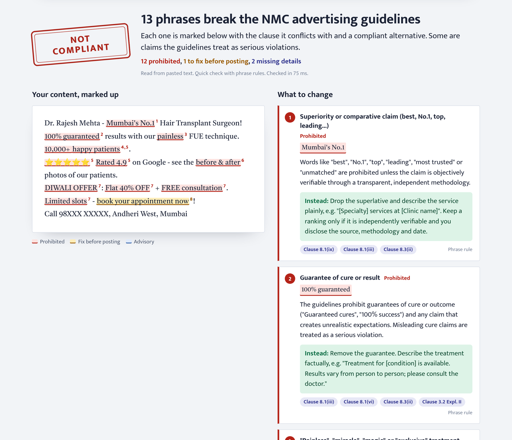

# AdRx: NMC ad compliance checker

Doctors, clinics, hospitals and their marketing agencies upload an ad (text, PDF, Word file, poster
image, WhatsApp voice note or video reel) and the tool tells them whether it conflicts with the
**NMC Guidelines on Ethical Advertising and Public Communication** (Public Notice
R-13014/01/2024-Ethics, 06-10-2026).

- If it is clear: **"No conflicts with the NMC advertising guidelines"**.
- If not: every problem word or phrase is **highlighted in the content**, with the clause it breaks
  (e.g. 8.1(iii), 8.1(ix), 8.1(x)), a plain-English reason, and compliant wording to use instead.
- It also lists missing mandatory details (doctor's name, qualifications, SMC/NMR registration
  number, "AI-generated" label), drafts a compliant version (AI mode), and shows the penalty ladder.

Works with English, Hindi (Devanagari) and Hinglish content.



> "AdRx" is a working name; change it in `static/index.html`. The tool is independent and not
> affiliated with the National Medical Commission. It gives guidance, not legal advice.

## How it works

```
upload ──► extract text ───────────────► check ────────────────────────────► result
           text / .docx: read directly    1. phrase rules (rules.yaml):         verdict stamp
           PDF: text layer, OCR if scanned   ~270 English/Hindi/Hinglish         highlighted text
           image: OCR (Tesseract eng+hin)    patterns -> clauses, severity       clause + why + fix
           audio: Whisper speech-to-text  2. AI review (Claude, optional):      missing disclosures
           video: Whisper + OCR of frames    confirms/dismisses rule flags,      compliant rewrite
                  + key frames for AI        finds subtler issues, checks        penalty ladder
                                             images, writes a rewrite
```

- **Quick check mode** (no API key): rules only. Instant, free, deterministic.
- **AI mode** (`ANTHROPIC_API_KEY` set, see the steps below): Claude reviews the text and images against the full
  guideline text, removes rule false positives (e.g. "best" in "best wishes"), adds what the rules
  missed, and writes a compliant version. If the AI call fails, the rules result is still returned.

## Supported files

- **Audio:** any format ffmpeg can play, e.g. WhatsApp voice notes (.opus/.ogg), MP3, M4A/AAC, WAV,
  AMR/3GA (Android), CAF (iPhone), WMA, FLAC, AIFF, AC3, MKA, WebM audio, SPX, WavPack and more.
- **Video:** any format ffmpeg can play, e.g. MP4, MOV (including iPhone HEVC), MKV, WebM, AVI, 3GP, WMV,
  FLV, MPEG-TS (.ts/.m2ts), MPG, VOB, OGV, DV, MXF, AV1. The app reads the speech, any subtitle track
  inside the file, and the text shown on screen: dark, white, coloured and outlined captions, from up
  to 24 frames (one about every 2 seconds; further apart in videos longer than 48 seconds).
- **Images:** PNG, JPG, WebP, GIF, BMP, TIFF, HEIC/AVIF (when ffmpeg can decode them). Animated
  GIF/WebP/APNG ads are read frame by frame.
- **Documents:** PDF (including scans), Word (.docx), text, HTML, and subtitle files (.srt/.vtt/.ass).

Files with an unusual or missing extension are identified from their content. Uploads up to 500 MB
(`MAX_UPLOAD_MB`); the first 10 minutes of long recordings are checked (`MAX_MEDIA_SECONDS`).
The full format test matrix runs with `pytest -m formats`.

## Run it on Windows (double-click)

1. **Extract the zip first**: right-click it > **Extract All...** > Extract, e.g. into
   `C:\Users\<you>\hospital_project`. Don't run the .bat files from inside the zip window; Windows
   then copies out only that one file and the scripts can't be found.
2. Double-click **`setup.bat`** (one time, about 5 minutes). It checks Python, ffmpeg and Tesseract
   and offers to install whatever is missing with winget. In the Tesseract installer, open
   "Additional language data" and tick **Hindi**. It then installs the packages into `.venv`,
   creates `.env` and runs the self-test, which should end with `All tests passed`.
3. Double-click **`start.bat`**. The app opens at http://localhost:8000. Keep the black window open
   while you use it; press Ctrl+C there to stop it.
4. Optional: put your Anthropic key in `.env` and double-click **`check-ai.bat`** (see
   [Turn on AI review](#turn-on-ai-review-step-by-step)).

Tip: before unzipping, right-click the zip > **Properties** > tick **Unblock** > OK. Otherwise
Windows may warn about the .bat files; choose **More info > Run anyway** (they only run the scripts
in the `scripts` folder, which you can read first).

## Run it on macOS or Linux

Needs Python 3.11+, plus `ffmpeg` (audio/video) and `tesseract` with Hindi data (images, scanned PDFs).

```bash
# macOS:   brew install ffmpeg tesseract tesseract-lang
# Ubuntu:  sudo apt install ffmpeg tesseract-ocr tesseract-ocr-hin
python -m venv .venv && source .venv/bin/activate
pip install -r requirements-dev.txt
cp .env.example .env          # add your key for AI mode, see below
pytest                        # self-test
uvicorn app.main:app --reload
```

Open http://localhost:8000.

The first audio/video check downloads the Whisper model (`WHISPER_MODEL=small` ~ 500 MB). For
Hindi/Hinglish speech use `large-v3-turbo` (more accurate, slower on CPU), or set
`TRANSCRIBE_BACKEND=openai` to use a hosted Whisper API such as Groq or OpenAI.

## Check that it works

Try these in the browser and compare with what you should see:

| Try | You should see |
|---|---|
| Click the **English clinic post** example, then **Check compliance** | Red "Not compliant" stamp; "Mumbai's No.1", "100% guaranteed", "painless", "DIWALI OFFER" highlighted |
| Click **Hindi post** | Red stamp; "सबसे अच्छे", "जड़ से इलाज", "गारंटी", "मुफ्त" highlighted |
| Click **Compliant notice** | Green "Compliant" stamp, nothing to change |
| Upload `samples\poster_en.png` | Text read from the image, red stamp |
| Upload `samples\brochure_scanned.pdf` (choose "Hospital or clinic") | "India's most trusted", "99% success rate", "no side effects" highlighted |
| Upload `samples\reel_en.mp4` | Two parts, "Spoken words" and "On-screen text", both marked up. The first video takes a few minutes while the Whisper model downloads |
| Upload `samples\voice_note_hi.ogg`, Spoken language: Hindi | Hindi transcript with the offer and cure claims marked |
| Open http://localhost:8000/docs | The API page; **POST /api/check > Try it out** lets you test without the UI |

The line under the **Check compliance** button tells you the mode: "Quick check mode" (no key),
"AI review is on" (key works), or a yellow warning that says what to fix.

## Turn on AI review (step by step)

1. **Add credits.** Sign in to the Claude Console at https://platform.claude.com, open
   **Billing** (https://platform.claude.com/settings/billing) and click **Buy credits**. API use is
   prepaid; credits expire one year after purchase. Each check typically costs a few US cents, and
   the check command below prints an estimate.
2. **Create a key.** Open **API keys** (https://platform.claude.com/settings/keys), click
   **Create key**, give it a name (e.g. `adrx-server`), choose an expiration, and **select a
   workspace** (e.g. Default) so the key works on its own. Copy the key (it starts with `sk-ant-`);
   it is shown only once.
3. **Put it in `.env`** in the project folder (create it from `.env.example`):
   ```
   ANTHROPIC_API_KEY=sk-ant-...
   ```
   If you created the key without a workspace, also set `ANTHROPIC_WORKSPACE_ID=wrkspc_...`
   (Console > Settings > Workspaces, ID column). `.env` is in `.gitignore`; never commit it or paste
   the key into chats or screenshots.
4. **Check the connection:**
   ```bash
   python -m app.ai_check --quick    # key + model check, free
   python -m app.ai_check            # one real review of a sample ad (a few US cents)
   python -m app.ai_check --file samples/poster_en.png   # same, on any file (tests images too)
   ```
   Optional full live test: `RUN_LIVE_AI=1 pytest -m live -v`
   (Windows PowerShell: `$env:RUN_LIVE_AI=1; pytest -m live -v`).
5. **Start (or restart) the app** with `uvicorn app.main:app --reload`. The app reads `.env` at
   start-up, so restart it after editing `.env`. The line under the **Check compliance** button
   should now say "AI review is on (Claude Sonnet 5.5)". If it shows a yellow warning instead, the
   warning says what to fix.
6. **On a server** (Render, Railway, a VM): set the same variables in the host's environment or
   secrets settings instead of uploading `.env`.

| If you see | Do this |
|---|---|
| "The Anthropic API key was rejected" | The key is wrong, revoked or expired: create a new one, update `.env`, restart. |
| "out of credits" | Buy credits on the Billing page. |
| "not tied to a workspace" | Set `ANTHROPIC_WORKSPACE_ID`, or create the key inside a workspace. |
| "Model ... is not available to this API key" | Set `AI_REVIEW_MODEL` to a model your account can use. |
| "rate limit" or "Claude is busy" | Wait a minute. The app retries twice by itself and still shows the phrase-rule result. |
| "The AI review was cut off" | Raise `AI_MAX_TOKENS` (e.g. 24000). |

The AI call streams its answer, so long reviews (videos with several frames) don't hit HTTP time
limits. The 21 KB guideline text is sent as a cached system prompt, so repeat checks within a few
minutes pay about a twentieth of the normal price for it.

## Sign-in and user accounts

With `REQUIRE_LOGIN=on`, every page and every check needs an account. There are two roles:

- **Admin**: can use everything, and manages accounts on the **Users** page (`/admin`). An admin can add
  accounts, change names, roles and permissions, set new passwords, sign an account out everywhere, and
  deactivate or activate accounts. The page also lists recent activity: sign-ins, failed sign-ins and every
  change.
- **User**: can use only what an admin allowed:

| Permission | Allows |
|---|---|
| Paste text | Checking pasted text |
| Documents and images | PDF, Word, posters and other images |
| Voice notes and audio | Audio files and voice notes |
| Videos | Video files |
| AI review | The Claude review, when the server has an Anthropic key |

The server checks every permission on every request; hiding a button on the page is only a courtesy.

**Turn it on.** In `.env` (or your host's settings):

```
REQUIRE_LOGIN=on
ADMIN_PASSWORD=a-long-password-you-choose     # creates the "admin" account the first time
```

Start the app, sign in as `admin`, open **Users** and add accounts. You give each new account a first password
(the page suggests a random 10-character one), and its owner chooses their own at first sign-in. The same
suggestion and the same rule apply when you set a new password for an account.

**Where accounts are kept.** Without `DATABASE_URL`, accounts are kept in `data/accounts.db` (SQLite) in the
project folder. For the website, put them in Supabase's free Postgres by setting `DATABASE_URL` to its
connection string ([deploy/README.md](deploy/README.md)). On Postgres the tables live in their own schema,
`adrx`, which Supabase's public Data API doesn't publish, and row-level security is on as a second lock.

**How it's protected.**

- Passwords are stored as Argon2id hashes. Every password (new account, reset, or one people choose themselves)
  needs at least 10 characters, and 10 more than the username if it contains it. Very common ones are refused.
- A session is a random token in an HttpOnly, SameSite cookie (Secure, with the `__Host-` prefix, over HTTPS).
  Only the token's SHA-256 is stored.
- You're signed out after 12 hours without using the site (`SESSION_IDLE_HOURS`) and after 7 days in any case
  (`SESSION_MAX_DAYS`). Deactivating an account or setting a new password signs it out everywhere at once.
- Every change needs the session's CSRF token, and requests from other websites are refused.
- After 5 wrong passwords for one account from one address, that address waits 15 minutes. There are also
  limits of 20 per address and 50 per account. A wrong username and a wrong password get the same answer, in
  the same time.
- Pages are sent with a strict Content-Security-Policy, X-Frame-Options, HSTS (over HTTPS) and no caching.
- At least one active admin always remains. Admins can't deactivate themselves or remove their own admin role.

**From the command line** (same settings and database as the app):

```bash
python -m app.accounts list
python -m app.accounts create priya.shah --name "Dr Priya Shah" --permissions check_text,check_documents
python -m app.accounts create ops --admin
python -m app.accounts reset-password admin
python -m app.accounts deactivate priya.shah
```

**Forgot the admin password?** Run `python -m app.accounts reset-password admin`. On a host without a
command line (such as Render's free plan), set `ADMIN_PASSWORD` to a new password and `ADMIN_PASSWORD_RESET=on`,
restart, sign in, then set `ADMIN_PASSWORD_RESET` back to `off`.

## Put it online as a website

Two ways, both explained step by step in [deploy/README.md](deploy/README.md):

- **Free on Render**: `render.yaml` runs the app on Render's free plan straight from your GitHub repository
  (it keeps itself awake; speech-to-text runs on the server, or through Groq's free API for accurate Hindi).
- **Your own server**: `deploy/` installs Docker and starts the app behind Caddy, which gets a free HTTPS
  certificate, with one command.

Only people with an account can use the site. They get the quick check (AI review stays off, so it costs
nothing per check), with limits per account, files deleted after each check, and no setup hints or developer
pages.

## Run with Docker

```bash
docker build -t adrx .                      # add --build-arg PRELOAD_WHISPER=1 to bake in the model
docker run -p 8000:8000 --env-file .env adrx
```

The container listens on `$PORT` (default 8000), so it deploys as-is to Render, Railway, Fly.io,
Cloud Run or a VM.

## Configuration

| Variable | Default | What it does |
|---|---|---|
| `ANTHROPIC_API_KEY` | - | Turns on AI review. Without it: quick check (rules only). |
| `ANTHROPIC_WORKSPACE_ID` | - | Only for keys not scoped to a workspace (`wrkspc_...`). |
| `AI_REVIEW_MODEL` | `claude-sonnet-5-5` | Model used for the review. |
| `AI_REVIEW_EFFORT` | `medium` | `low` / `medium` / `high`: speed and cost vs depth. |
| `AI_MAX_TOKENS` / `AI_TIMEOUT_SECONDS` / `AI_MAX_IMAGES` | 16000 / 180 / 6 | Limits for one AI review. |
| `TRANSCRIBE_BACKEND` | `local` | `local` (faster-whisper), `openai` (compatible API), `none`. |
| `WHISPER_MODEL` | `small` | faster-whisper model, e.g. `small`, `medium`, `large-v3-turbo`. |
| `OPENAI_API_KEY`, `OPENAI_BASE_URL`, `OPENAI_TRANSCRIBE_MODEL` | - | For `TRANSCRIBE_BACKEND=openai`. |
| `OCR_LANGUAGES` | `eng+hin` | Tesseract languages. |
| `OCR_FRAME_SIDE` / `OCR_FRAME_WORKERS` / `MAX_VIDEO_FRAMES` | 1600 / 4 / 24 | Video frame reading: size, Tesseract processes at once, frames per video. Lower = faster and less memory. |
| `FFMPEG_THREADS` | 0 (one per CPU) | Threads ffmpeg decodes videos with. `1` on a small server: each thread holds its own frames (100+ MB for a 4K video). |
| `MAX_UPLOAD_MB` / `MAX_MEDIA_SECONDS` / `MAX_PDF_PAGES` | 500 / 600 / 30 | Input limits. |
| `BASIC_AUTH_USER`, `BASIC_AUTH_PASSWORD` | - | One shared password for the whole site (a quick demo; accounts are better). |
| `REQUIRE_LOGIN` | `off` | `on`: every page and check needs an account (see Sign-in and user accounts). |
| `ADMIN_USERNAME` / `ADMIN_PASSWORD` | `admin` / - | The first admin account, created at start-up while it doesn't exist. |
| `ADMIN_PASSWORD_RESET` | `off` | `on`: at start-up, set the admin's password to `ADMIN_PASSWORD` (forgotten password). |
| `DATABASE_URL` | - | Keep accounts in Supabase or another Postgres; empty = SQLite file in `DATA_DIR`. |
| `DATABASE_PASSWORD` | - | The database password, put in place of `[YOUR-PASSWORD]` in `DATABASE_URL` (so the address can be pasted as Supabase shows it). |
| `DATA_DIR` | `data` | Folder for the SQLite accounts file. |
| `SESSION_IDLE_HOURS` / `SESSION_MAX_DAYS` | 12 / 7 | Signed out after this long without using the site / in any case. |
| `PUBLIC_SITE` | `false` | Visitors' view: no setup hints, no `/docs` API pages. |
| `AI_REVIEW` | `on` | `off` keeps AI review off even when a key is set. |
| `RATE_LIMIT_PER_HOUR` / `RATE_LIMIT_PER_DAY` | 0 / 0 | Checks per visitor (IP address); 0 = no limit. |
| `MAX_PARALLEL_CHECKS` / `QUEUE_WAIT_SECONDS` | 0 / 120 | Files processed at once (0 = no limit) and how long others wait. |
| `KEEP_AWAKE` / `KEEP_AWAKE_MINUTES` | `off` / 10 | For free hosts that sleep when idle: the app opens its own address every few minutes. The address is Render's `RENDER_EXTERNAL_URL`, or set `KEEP_AWAKE_URL`. |

## API

`POST /api/check` (multipart form):

| Field | Values |
|---|---|
| `text` | Text to check, or the caption that goes with an uploaded file |
| `file` | PDF, .docx, .txt, image, audio (mp3, m4a, ogg/opus, wav...) or video (mp4, mov, webm...) |
| `publisher` | `rmp` (doctor), `hospital`, `agency`, `other` |
| `channel` | `social`, `youtube`, `website`, `whatsapp`, `tv_radio`, `print`, `hoarding`, `other` |
| `ai_used` | `no`, `yes`, `unsure` |
| `language` | `auto`, `en`, `hi` (spoken language for audio/video) |

```bash
curl -F "text=Mumbai's No.1 skin clinic! 50% off this Diwali" http://localhost:8000/api/check
curl -F "file=@samples/reel_en.mp4" -F publisher=rmp -F channel=social http://localhost:8000/api/check
```

The response has `verdict` (`compliant` / `needs_changes` / `non_compliant`), `headline`, `summary`,
`findings` (each with `quotes` and character `spans`, `clauses`, `why`, `fix`, `severity`),
`highlights`, `missing_disclosures`, `compliant_rewrite`, `penalty`, `source`, `analysis`.
Interactive docs: http://localhost:8000/docs (hidden when `PUBLIC_SITE=true`)

With sign-in on, a script signs in first and then sends the session cookie and the CSRF token:

```bash
curl -c cookies.txt -H "Content-Type: application/json" \
     -d '{"username": "priya.shah", "password": "..."}' http://localhost:8000/api/auth/login   # returns csrf_token
curl -b cookies.txt -H "X-CSRF-Token: <csrf_token>" -F "text=..." http://localhost:8000/api/check
```

Accounts: `POST /api/auth/login`, `POST /api/auth/logout`, `GET /api/auth/me`, `POST /api/auth/password`.
Admins: `GET/POST /api/admin/users`, `PATCH /api/admin/users/{id}`, `POST /api/admin/users/{id}/password`,
`POST /api/admin/users/{id}/sign-out`, `GET /api/admin/activity`.

## Project layout

```
app/
  main.py                    FastAPI app (UI + /api/check + /api/health)
  config.py                  settings from environment
  accounts/                  sign-in, roles and permissions, admin API, accounts database (SQLite or Postgres)
  keep_awake.py              keeps a free Render site from falling asleep
  extract/                   text from PDF, images (OCR), Word, audio/video (ffmpeg + Whisper)
  engine/
    rules.py                 phrase-rule engine
    disclosures.py           name / qualification / registration / AI-label checks (3.2 Expl. III-IV, 7.2)
    ai_review.py             Claude review with structured JSON output
    checker.py               merges rules + AI, verdict, highlights, penalty
  knowledge/
    nmc_guidelines_2026.md   guideline text given to the AI reviewer
    rules.yaml               red-flag phrases -> clauses (edit this to tune the rules)
static/                      web UI (no build step): checker, sign-in, password and admin pages; self-hosted fonts
deploy/                      public website: docker-compose + Caddy (HTTPS), server settings, setup script
samples/                     test ads: posters (EN/HI), scanned + text PDFs, Word script, audio, reel
tests/                       pytest suite (rules, checker, AI path with mocked API, upload endpoints)
```

### Tuning the rules

Add or edit patterns in `app/knowledge/rules.yaml`. Each rule has a severity, clauses, an
explanation and a suggested fix. Add a test line to `tests/test_rules.py` for every new pattern
(both a phrase it must catch and a harmless phrase it must not), then run `pytest`.

When NMC issues clarifications (clause 12), update `nmc_guidelines_2026.md` and the rules.

## Tests

```bash
pip install -r requirements-dev.txt
pytest
```

The AI-review tests run the real Anthropic SDK against a mocked HTTP endpoint, so they need no API
key and make no network calls.

## Before going live

- **Access and cost control**: every AI check costs money. The website setup in `deploy/` needs an
  account for every check, keeps AI review off and limits checks per account. To offer AI review, set
  `ANTHROPIC_API_KEY` and `AI_REVIEW=on`, then give the "AI review" permission only to the accounts that
  should have it.
- **Long videos**: checks run inside the request. For many users or long videos, move extraction to
  a background job queue and poll for the result.
- **Privacy**: uploads are processed in a temp folder and deleted straight away; nothing is stored
  except accounts (username, name, password hash, role, permissions) and the activity log (sign-ins with
  IP addresses, changes), which keeps the newest 10,000 entries.
  Content is sent to Anthropic (and to the transcription API if you use `openai`). Mention this in
  your privacy policy (Digital Personal Data Protection Act, 2023), and remind users not to upload
  patient-identifying material.
- **Accuracy**: OCR and speech-to-text can mis-read words, so the tool shows the extracted text it
  checked. Keep the "guidance, not legal advice" disclaimer.
